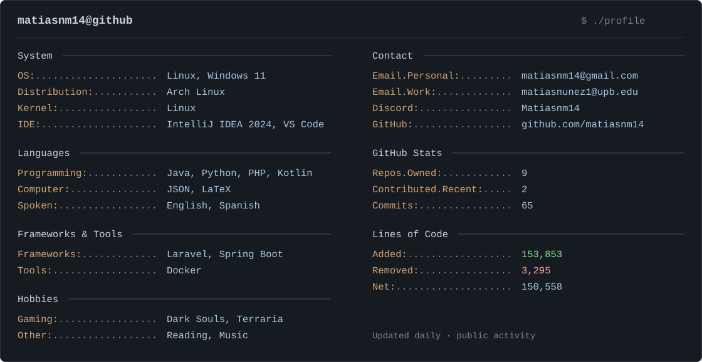

<details>
<summary>Profile in plain text</summary>

```yaml
matiasnm14 ─────────────────────────────────────────────────────

OS: ..................... Linux, Windows 11
Distribution: ........... Arch Linux
Kernel: ................. Linux
IDE: .................... IntelliJ IDEA 2024, VS Code

# Languages ───────────────────────────────────────────────────
Languages.Programming: .. Java, Python, PHP, Kotlin
Languages.Computer: ..... JSON, LaTeX
Languages.Real: ......... English, Spanish

# Frameworks & Tools ──────────────────────────────────────────
Frameworks: ............. Laravel, Spring Boot
Tools: .................. Docker

# Hobbies ─────────────────────────────────────────────────────
Hobbies.Gaming: ......... Dark Souls, Terraria
Hobbies.Other: .......... Reading, Music

# Contact ─────────────────────────────────────────────────────
Email.Personal: ......... matiasnm14@gmail.com
Email.Work: ............. matiasnunez1@upb.edu
Discord: ................ Matiasnm14
```

<!-- GITHUB-STATS:START -->
```diff
# GitHub Stats ────────────────────────────────────────────────
   Repos.Owned: ··············· 9
   Repos.Contributed.Recent: ·· 2
   Commits: ··················· 65
++ Lines.Added: ··············· 153,853
-- Lines.Removed: ············· 3,295
   Lines.Net: ················· 150,558
```
<!-- GITHUB-STATS:END -->

</details>

<details>
<summary>About these statistics</summary>

Updated automatically every day at 00:17 Bolivia time (04:17 UTC), or manually from **Actions → Update profile stats → Run workflow**.

- **Repos.Owned:** public repositories owned by this account, including forks.
- **Repos.Contributed.Recent:** other public repositories with recent commit contributions, as returned by GitHub. This is not an all-time list.
- **Commits / Lines:** commits authored by this account and reachable from the default branches of those repositories. Identical commit hashes are counted once, including across forks. Private repositories and commits GitHub cannot associate with this account are excluded.
- **Lines.Added / Removed / Net:** accumulated lines added, removed, and their difference in those commits. These include text files such as documentation and generated files; they do not measure unique code currently present or code quality.

</details>
